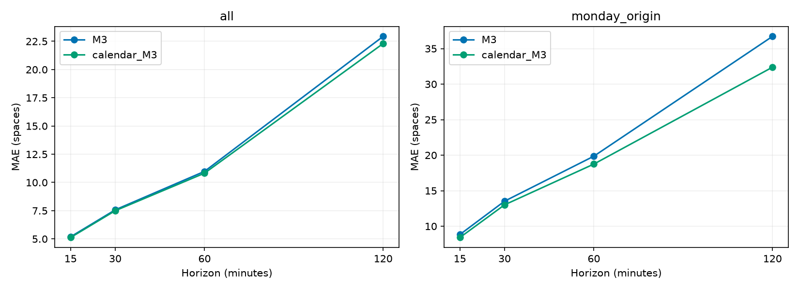

# GSU 학사 일정·휴일 정보 추가 결과

공식 GSU Full Semester 일정과 학교 휴무, OPM 연방 공휴일을 구분해 추가했다. 기존 수집 workflow/CSV와 공개 운영 M3 예측 계수는 유지했다.

## 확인한 일정

- 2026-09-07: GSU Labor Day 휴일. 연방 공휴일이기도 하다.
- 2026-10-12: 연방 Columbus Day지만 풀 학기 수업 기간의 평일이며, 확인된 GSU 휴무 목록에 포함하지 않는다. 미니학기 시작·종료는 분류에 사용하지 않는다.
- 2026-11-23–28: Full Semester Thanksgiving 수업 휴식. 11월 26–27일의 학교 휴무는 따로 구분한다. 확인한 일정이 28일까지이므로 임의로 29일까지 수업 휴식 범위를 늘리지 않았다.
- 2026-12-21–2027-01-03: GSU 겨울 휴무. 학기 수업 종료는 12월 7일이다. 일반 학기 범위 밖이며 휴무 목록에도 없는 날짜는 unknown으로 남긴다.

일반 날짜의 `term_weekday`는 학기 범위에 따른 일정 분류다. 실제로 모든 학생이 수업을 듣는다는 뜻은 아니다. 학과별 예외·행사·임시 폐쇄는 포함하지 않았다. 일정은 2026-10-13에 확인한 정적 버전으로 저장했으며 다음 학기를 자동 추측하지 않는다.

## 실제 평가

Phase 2의 원본 11,683건 및 동일 matched origins를 재사용했다. 9월 17–23일 validation, 9월 24일 이후 test. 후보는 평소 평일 기준선에서 확인된 GSU 휴일/수업 휴식 기록을 제외하는 방식이다. alpha와 경고 cutoff는 재조정하지 않았다. 원본 음수 74건과 모든 음수 예측을 유지했다.

자료 기간의 확인된 GSU 예외 날짜는 **9월 7일 하루**이며 초기 과거 학습 기간에 있다. validation/test의 실제 GSU 휴일 target 날짜는 모두 **0개**다. 따라서 이번 비교는 “평소 월요일 기준선에 휴일을 섞었을 때의 영향”을 살펴본 것이며 휴일 당일 예측 성능 실험이 아니다. 테스트 기간의 10월 12일을 임의로 휴일로 처리하지 않았다.

| 분 | 동일 테스트 n | 기존 MAE | 후보 MAE | 기존 RMSE | 후보 RMSE | MAE 감소율 |
|---|---|---|---|---|---|---|
| 15 | 5572 | 5.184 | 5.122 | 10.588 | 10.476 | 1.18% |
| 30 | 5568 | 7.574 | 7.496 | 14.876 | 14.787 | 1.02% |
| 60 | 5557 | 10.981 | 10.822 | 20.354 | 20.258 | 1.45% |
| 120 | 5533 | 22.935 | 22.301 | 31.289 | 30.391 | 2.77% |

월요일 origin만 비교하면 다음과 같다. 다른 요일은 같은 요일 기록을 사용하므로 대부분 변화가 없다.

| 분 | 월요일 n | 기존 MAE | 후보 MAE |
|---|---|---|---|
| 15 | 829 | 8.827 | 8.407 |
| 30 | 827 | 13.522 | 13.008 |
| 60 | 822 | 19.855 | 18.745 |
| 120 | 812 | 36.718 | 32.381 |

오차 감소는 소폭이며 효과가 한 휴일 기록과 소수 월요일에 의존한다. 5분 표본은 독립이 아니다. 이전에 이미 본 Phase 2 test를 반복 사용한 탐색 비교이므로 새로운 독립 테스트나 통계적 유의성을 주장하지 않는다. 과거 각 origin 당시의 공식 달력 게시 버전도 보관되어 있지 않아, 일정 라벨의 완전한 사전 가용성을 입증하지 못한다. 날짜별 지표, 실제값/기존·후보 예측, 각 날짜 라벨은 `calendar_results/`에 보존했다.

## 서비스에 반영한 범위

1. 화면에 관측 날짜의 학사 일정 구분을 표시한다. 연방 공휴일과 GSU 휴무를 별도로 취급한다.
2. 공개 JSON에 `calendar` metadata와 `shadow_predictions`를 추가한다. **화면의 운영 forecasts는 기존 M3**다.
3. 휴일 구분 후보는 같은 CSV로 별도 계산하지만 사용자 화면의 예측·경고를 대체하지 않는다. 휴일 target에 과거 예외 날짜가 2개 미만이면 기존 기준선으로 fallback한다. 주말/일정 미확인도 기존 기준선을 유지한다. 이 fallback은 개선이 검증된 휴일 전용 모델이 아니다.
4. 실행마다 운영·후보 예측과 calendar version/source revision을 Actions artifact로 90일 보관한다. 앞으로 실제 휴일 target의 정답이 생기면 기록된 사전 예측으로 평가할 수 있다.
5. 원본 CSV는 변경하지 않고 `annotate_calendar.py`로 날짜별 별도 감사 CSV를 생성한다. 수집 방식은 그대로다.

학사 일정 분류 6개 추가 검증, 기존 exporter 11개 검증, 프런트엔드 7개 검증을 통과했다. 기존 운영 예측은 Phase 2 산식과 재대조했다. calendar schema의 미확인 날짜는 false로 숨기지 않고 null/unknown으로 표시한다.

## 다음 평가

새로운 휴일·휴식 날짜가 관측되면 휴일 당일, 전후 날, 일반 평일을 날짜별로 분리해 실제 오차와 만차/혼잡 사건을 비교한다. 여러 독립 휴일 날짜를 확보하고 새 미래 구간에서 개선을 확인한 다음 운영 교체를 판단한다. 후보의 자동 승격은 구현하지 않았다.

## 공식 출처와 실행

- [GSU Labor Day 공식 달력](https://calendar.gsu.edu/calendar/day/2026/9/7)
- [GSU 수업 시작](https://calendar.gsu.edu/event/classes-begin)
- [GSU 수업 종료](https://calendar.gsu.edu/calendar/day/2026/12/7)
- [GSU Thanksgiving 수업 휴식](https://calendar.gsu.edu/event/thanksgiving-break-full-semester-mmii)
- [GSU 직원 휴무·겨울 폐쇄 일정](https://hr.gsu.edu/benefits/time-off-and-time-away/)
- [OPM 연방 공휴일](https://www.opm.gov/policy-data-oversight/pay-leave/federal-holidays/)

저장소 실행: `python model/phase3/annotate_calendar.py --csv data/parking.csv --out calendar-audit.csv`.
기존 exporter와 workflow는 metadata/후보 계산 및 artifact 기록을 함께 수행한다. 학사 일정은 `model/phase3/academic_calendar.json`에서 버전과 출처를 관리한다.
