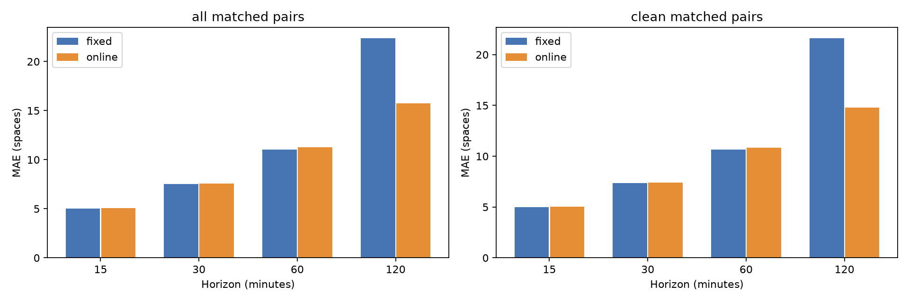
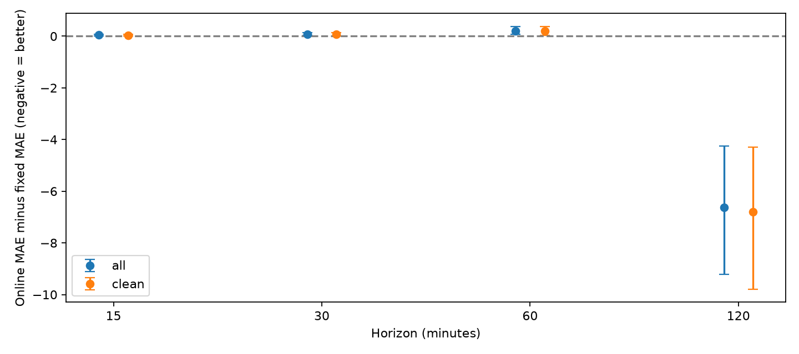
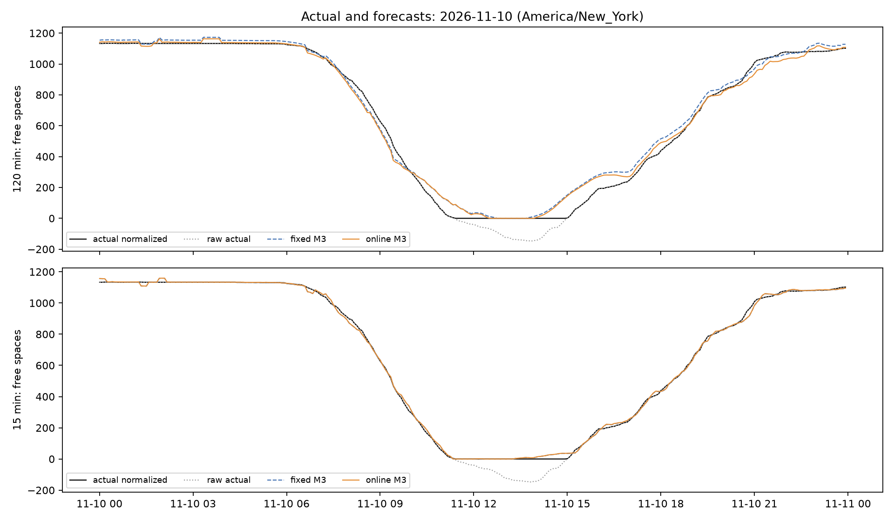

# Phase C 오프라인 검증 결과

**현재 온라인 학습은 모든 horizon에서 더 정확하지 않다.** 고정 α M3 대비 최종 테스트의 120분 MAE는 **29.68% 감소**했다. 반면 15·30·60분 MAE는 각각 **0.89%·1.05%·1.87% 증가**했다. clipping 없는 표본도 같은 방향이다. 따라서 전체 운영 교체는 권하지 않으며, 별도 승인을 전제로 120분 후보를 중심으로 shadow 관찰하는 것이 타당하다. **mode는 off이고 운영 모델·Pages 설정은 변경하지 않았다.**

## 1. 시간 분리와 비교 설계

소스 커밋 `06237c8c2737c19631d8b3c1455925cf23d962b7`의 CSV를 별도 로컬 파일로 고정했다. 수집 파일 자체는 수정하지 않았다. 수집 스냅샷 20,259건 중 11월11일까지 **20,083건**만 재생했다. 테스트 원시 관측은 **4,068건**, `2026-10-29T00:00:19-04:00`~`2026-11-11T23:55:13-05:00`다. 이후 관측은 기준선·학습·정답 매칭에 사용하지 않았다.

* 검증: 10월15~28일. 그 이전 자료는 초기 기준선·온라인 학습 준비에 사용했다.
* 후보: 반감기7/14/28일 × 사전 강도50/200/800 × α 상한1.5/2/3, 총27개.
* 선택 기준: 전체 matched pair에서 네 horizon MAE의 동일 가중 평균. clean·경고·최종 테스트 점수로 설정을 고르지 않았다.
* 선택: **반감기14일, 사전 강도50, α 범위[0,2]**. 사전 특징 규모100대·최소20쌍 등 나머지는 고정했다. 상한1.5/2/3은 이번 검증에서 예측이 같아 사전에 정한 동률 규칙으로2를 택했다. 실질적으로 다른 점수는9개였다.
* 선택 파일과 프로토콜을 커밋 **`afcdf38da`**로 먼저 고정한 뒤 테스트를 평가했다. 검증 선택 objective는 **8.930005대**다. 설정 간 점수 차이가 작아 유일한 최적 설정이라고 주장하지 않는다.
* 테스트: 10월29일~11월11일. 설정은 고정하고, 각 테스트 정답이 관측된 이후에만 α를 순차 갱신했다. 이는 매 시점 이전 자료로 다음을 예측하는 prequential 평가다.

운영 고정값은 15/30/60분 α=1, 120분 α=.75다. 모든 신정책 비교군은 동일한 유한값 clipping·동일 origin·동일 정답·동일 경고 cutoff를 사용한다. 기존 공개 모델의 수용량 거부 정책은 별도 대조군으로만 분리했다. ±90초 매칭 창이 닫히기 전에는 학습하지 않았고, 예측 당시 기준선·특징을 정답 도착 후 다시 계산하지 않았다.

검증 성능(고정 → 선택 후보):

| 분 | n | 고정 MAE | 온라인 MAE | 변화 |
|---|---|---|---|---|
| 15 | 3855 | 4.547 | 4.562 | +0.32% |
| 30 | 3848 | 6.497 | 6.523 | +0.40% |
| 60 | 3836 | 9.725 | 9.775 | +0.52% |
| 120 | 3812 | 18.883 | 14.860 | -21.31% |

## 2. 최종 테스트: 전체 자료

편향은 `예측−정답`이며 양수는 빈자리를 과대 예측한 것이다. 단위는 주차 대수다.

| 분 | 동일 쌍 n | MAE 고정 → 온라인 | RMSE 고정 → 온라인 | 편향 고정 → 온라인 | MAE 변화 |
|---|---|---|---|---|---|
| 15 | 3954 | 5.033 → 5.077 | 9.106 → 9.101 | 0.189 → 0.147 | +0.89% |
| 30 | 3946 | 7.510 → 7.589 | 13.125 → 13.105 | 0.382 → 0.313 | +1.05% |
| 60 | 3936 | 11.051 → 11.258 | 18.713 → 18.638 | 0.739 → 0.588 | +1.87% |
| 120 | 3919 | 22.359 → 15.722 | 28.956 → 24.514 | -0.917 → 1.013 | -29.68% |

네 horizon MAE를 동일 가중 평균하면 **11.488 → 9.912대**다. 이 평균 개선은 120분 결과가 주도한다. 온라인 최소제곱은 제곱오차를 학습하므로, 일부 큰 오차를 줄여 RMSE가 소폭 낮아져도 보통 표본의 MAE는 악화될 수 있다. 따라서 RMSE만으로 모든 horizon의 개선을 주장하면 안 된다. 날짜별 온라인 MAE 개선 일수는 15/30/60/120분에서 **2/3/3/14일**(각14일 중)이었다.

## 3. clipping 없는 표본

clean은 **origin 원본과 매칭된 정답 원본이 모두 [0,1300]인 쌍**이다. 같은 모델의 평가 표본만 나눈 것이며, 학습 이력에서 clipping 자료를 제거하고 재학습한 실험이 아니다. 전체 15,755쌍 중 clean은 15,150쌍이다. clipping 관련 쌍은 `test_metrics.csv`의 `clipping_involved`에 별도 보존했다.

| 분 | clean n | MAE 고정 → 온라인 | RMSE 고정 → 온라인 | 편향 고정 → 온라인 | MAE 변화 |
|---|---|---|---|---|---|
| 15 | 3827 | 4.988 → 5.028 | 9.012 → 8.996 | -0.017 → -0.065 | +0.80% |
| 30 | 3810 | 7.346 → 7.417 | 12.741 → 12.691 | -0.032 → -0.116 | +0.96% |
| 60 | 3784 | 10.657 → 10.852 | 17.717 → 17.578 | -0.045 → -0.228 | +1.83% |
| 120 | 3729 | 21.601 → 14.805 | 26.994 → 22.424 | -2.743 → -0.472 | -31.46% |

120분 개선이 clipping 표본에만 의존하지 않는 반면, 단기 MAE 악화도 clean에서 남았다. 테스트 원시 관측에는 음수 **125건**, 정확한0 **0건**, 1300초과 **0건**이 있었다. 보고 수용량 차이는 2394건으로, 제외/비례 환산하지 않았다.

## 4. 날짜 단위 불확실성

같은 origin 날짜의 고정·온라인 오차를 함께 묶어14일을 복원추출하는 paired day-block bootstrap을2,000회 실행했다(seed20261112). 차이는 `온라인 MAE−고정 MAE`로 **음수가 개선**이다.

| 표본 | 분 | MAE 차이 | 날짜 bootstrap 95% 구간 | 자료가 있는 날짜 |
|---|---|---|---|---|
| all | 15 | 0.045 | [0.016, 0.076] | 14 |
| all | 30 | 0.079 | [0.028, 0.141] | 14 |
| all | 60 | 0.207 | [0.065, 0.374] | 14 |
| all | 120 | -6.637 | [-9.224, -4.260] | 14 |
| clean | 15 | 0.040 | [0.014, 0.069] | 14 |
| clean | 30 | 0.071 | [0.015, 0.136] | 14 |
| clean | 60 | 0.195 | [0.037, 0.380] | 14 |
| clean | 120 | -6.796 | [-9.788, -4.296] | 14 |

이번14일 안에서는 단기 MAE 악화와120분 개선의 방향이 비교적 일관됐다. 다만14일은 짧고, 날짜 간 독립성·대표성이나 여러 비교를 보정한 확증적 유의성을 입증하지 않는다. 같은5분 기록과 겹치는 horizon을 독립 표본으로 세지 않았다. 다음 학기·휴일·다른 수요 국면으로 일반화할 근거는 없다.

## 5. 혼잡 경고와 만차

정답 사건은 **정규화된 API 잔여 대수<=0**이다. 실제 현장의 만차를 별도 센서로 확인한 정답은 아니다. cutoff0은 정확한 만차 예측, 25/25/50/100은 기존 혼잡 경고다. P/R/F1은 precision/recall/F1 순서이며 —는 분모가 없어 정의되지 않은 값이다. FP/FN은 겹치는 예측-정답 쌍 수다.

| 분 | cutoff | 고정 P/R/F1 | 온라인 P/R/F1 | FP 고정 → 온라인 | FN 고정 → 온라인 |
|---|---|---|---|---|---|
| 15 | 0 | 0.981/0.432/0.600 | 1.000/0.432/0.604 | 1 → 0 | 67 → 67 |
| 15 | 25 | 0.865/0.924/0.893 | 0.865/0.924/0.893 | 17 → 17 | 9 → 9 |
| 30 | 0 | 0.982/0.462/0.629 | 0.981/0.445/0.613 | 1 → 1 | 64 → 66 |
| 30 | 25 | 0.868/0.832/0.850 | 0.876/0.832/0.853 | 15 → 14 | 20 → 20 |
| 60 | 0 | 0.935/0.483/0.637 | 0.966/0.467/0.629 | 4 → 2 | 62 → 64 |
| 60 | 50 | 0.697/0.900/0.785 | 0.706/0.900/0.791 | 47 → 45 | 12 → 12 |
| 120 | 0 | 0.891/0.430/0.580 | 0.864/0.500/0.633 | 6 → 9 | 65 → 57 |
| 120 | 100 | 0.408/0.974/0.575 | 0.446/0.974/0.612 | 161 → 138 | 3 → 3 |

120분 경고(cutoff100)는 recall을 유지하면서 FP를161→138로 줄였다. 하지만 FP는 여전히 많고, 정확한 만차(cutoff0)는 recall 상승과 함께 FP도6→9로 늘었다. 단기 경고 개선은 작거나 없었다. clean 표본에는 이번 테스트에서 만차 정답이 없어 만차 recall을 평가할 수 없다. `test_metrics.csv`에 undefined를 빈 값으로 남겼다.

원시 자료의 정규화 만차는 4개 날짜, 연속된0이하 기록이 양수 관측 또는10분 초과 gap으로 끊기는 정의에서 **5개 구간**이었다. 같은 구간의 여러 예측을 독립적인 만차 사건으로 해석하지 않는다. clipping으로0이 된 음수 값에 경고 성능이 의존한다는 한계가 있다.

## 6. 요일·시간대

평일 오전06~10시:

| 분 | n | 고정 MAE | 온라인 MAE | 변화 |
|---|---|---|---|---|
| 15 | 460 | 7.988 | 7.982 | -0.08% |
| 30 | 457 | 12.485 | 12.425 | -0.49% |
| 60 | 457 | 18.810 | 18.704 | -0.56% |
| 120 | 455 | 27.618 | 26.091 | -5.53% |

120분 시간대별(모든 요일):

| origin 현지 시간 | n | 고정 MAE | 온라인 MAE |
|---|---|---|---|
| 00-06 | 1005 | 16.851 | 5.900 |
| 06-10 | 648 | 25.695 | 21.047 |
| 10-14 | 638 | 26.295 | 23.107 |
| 14-18 | 653 | 29.031 | 21.648 |
| 18-24 | 975 | 18.775 | 13.508 |

120분 요일별:

| 요일 | n | 고정 MAE | 온라인 MAE |
|---|---|---|---|
| 월 | 554 | 25.567 | 20.933 |
| 화 | 569 | 30.152 | 24.753 |
| 수 | 493 | 24.011 | 18.838 |
| 목 | 558 | 24.690 | 21.407 |
| 금 | 572 | 20.363 | 13.361 |
| 토 | 583 | 15.943 | 6.838 |
| 일 | 590 | 16.520 | 5.209 |

다른 horizon의 요일·시간대별 MAE/RMSE/편향·경고 지표도 CSV에 포함했다. 개별 요일은 약2일뿐이므로 특정 요일의 우열을 별도 모델 선택 기준으로 사용하지 않았다.

## 7. 과거 정규화 정책과의 분리

아래는 구정책 고정 M3도 평가 가능한 동일 origin/정답에 한정한 MAE다. primary 결론은 신정책 고정 α와 온라인 α의 비교에서 얻었으며, clipping 변경 효과를 온라인 학습 효과로 섞지 않았다.

| 분 | 공통 n | 구정책 고정 | 신정책 고정 | 신정책 온라인 |
|---|---|---|---|---|
| 15 | 3925 | 4.968 | 4.964 | 5.006 |
| 30 | 3914 | 7.358 | 7.358 | 7.432 |
| 60 | 3898 | 10.746 | 10.746 | 10.942 |
| 120 | 3878 | 21.896 | 21.882 | 15.267 |

## 8. 증분 계산·재시작·손상 안정성

최종 테스트 **15,755개 예측·3,975개 origin 전부**를 원래 배치 기준선과 대조했다. 날짜 cutoff/대상 요일·분이 같은 질의만 정확하게 재사용했고, 배치 질의는 4,457회였다. 최대 기준선/특징 차이는 1.14e-12대, 고정 예측 차이는 1.59e-12대, 온라인 예측 차이는 1.36e-12대였다. 차이는 부동소수점 수준이다.

후보27개는 α와 무관한 인과적 기준선/특징 및 정답 공개 이벤트를 재사용해 계산했다. 캐시 재생과 실제 Phase B 기본 엔진의 예측 최대 차이는 **0**이었다. 선택된 설정을 실제 엔진으로 다시 재생한 optimizer 상태도 캐시의 선택 후보와 일치했다. 따라서 후보 sweep만 별도 수학을 구현해 잘못 평가하는 위험을 점검했다.

실제20,083건의 상태 스트레스에서는 다음이 통과했다.

* 10월28일 이후 실행을 모두 놓쳤다고 가정해 테스트 신규4,068건을 한 번에 따라잡기.
* 12시간마다28회 상태 저장·프로세스 재시작 후 이어 처리하기.
* 최신 상태를 손상시킨 뒤 이전 정상 상태를 복원하고 신규 자료 재처리하기.
* 동일 파일5회 재실행: 신규 학습0건, 상태 불변.
* 현재/이전 상태 모두 손상: CLI 성공, status=ok, 네 고정 M3 예측을 정상 생성.
* 과거 CSV prefix 값 손상: 감지 후 상태 불변.

연속·재시작·손상 복구의 최종 상태 SHA256은 모두 `467265fddf270c7a47722502adae4544fddaf085a8c7ece887608bd9ab8db682`로 같았다. 최종 상태 크기는 **775,540바이트**다. 테스트4,068건 한 번의 catch-up은 약 6.49초, 동일 입력 복원/검증 중앙값은 약 0.074초였다. Python/로컬 환경의 측정이며 GitHub 네트워크·배포 지연 성능 보장은 아니다. 상세 실제 수치는 `stability.json`, `full_baseline_parity.json`에 보존했다.

## 9. 판단과 다음 단계

**“온라인 학습이 기존 고정 α M3보다 실제로 더 정확한가?”에 대한 답은 “120분은 개선됐지만,15~60분의 MAE는 악화됐다”이다.** 전체 자동 교체는 권하지 않는다. 120분 이득은 clean에서도 유지됐고 날짜별 비교에서도 나타났으므로, 별도 승인 후 운영 예측을 바꾸지 않는 shadow 관찰 대상으로 삼을 근거는 있다. 단기 후보도 같은 shadow 기록에서 관찰하되 개선 모델이라고 부르면 안 된다.

최종 테스트를 본 뒤 horizon별 설정이나 α 정책을 다시 고르지 않았다. 향후 단기 전용 최적화나 고정/온라인 혼합 후보를 연구하려면 새 과거 검증 구간과 아직 보지 않은 미래 평가가 필요하다. 제곱오차 학습과 MAE 평가의 차이, 휴일/학기 변화, 음수 API 관측의 의미, 작은 만차 사건 수가 남은 한계다.

또한 이번 대조군은 기존 검증에서 선택한 고정 α이며, 최근 검증으로 다시 고른 정적 α 대조군은 포함하지 않았다. 따라서120분 개선이 지속 적응 자체의 효과인지, 단순히 기존 .75보다 높은 α가 이 기간에 잘 맞았기 때문인지는 분리하지 못한다. 이 역시 다음의 별도 미래 검증에서 확인할 사항이다.

이번 선택 사전 강도50은 **결과 파일에만** 저장했다. 실제 `online_config.json`은 Phase B의 mode=off·사전 강도200 그대로다. source CSV·고정 α·수집 workflow·예측 workflow·웹사이트·Pages 설정을 변경하지 않았다. shadow 승인 시에도 검토된 선택 설정 반영과 해당 fingerprint의 명시적 bootstrap이 별도로 필요하다.

## 재현

`PROTOCOL.md`, `selection.json`, 후보표, 검증/테스트 예측 CSV와 지표 CSV, 날짜 bootstrap CSV, 원본 범위 감사, 안정성·전체 기준선 대조 JSON, 그림을 함께 제공한다. 수집 CSV는 계속 늘어나므로 위 소스 커밋의 파일을 별도 경로로 추출해 사용한다. 실행 순서·명령은 `REPRODUCE.md`에 있다. 원래 selection은 테스트 전에 고정한 커밋에 보존돼 있으며, 재현 실행의 시간/캐시 압축 해시 등은 달라질 수 있다.
