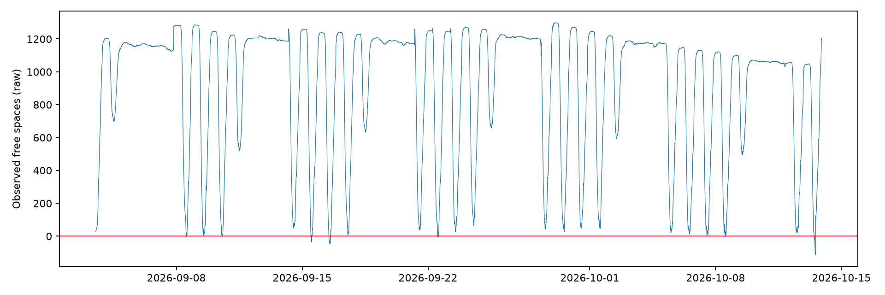
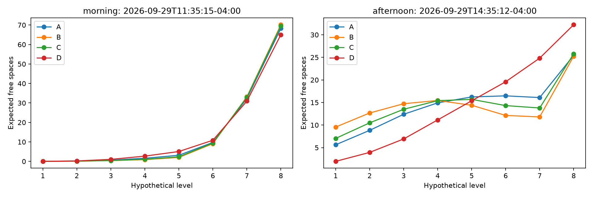
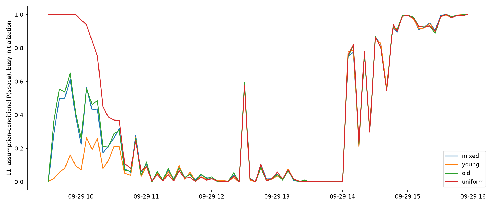
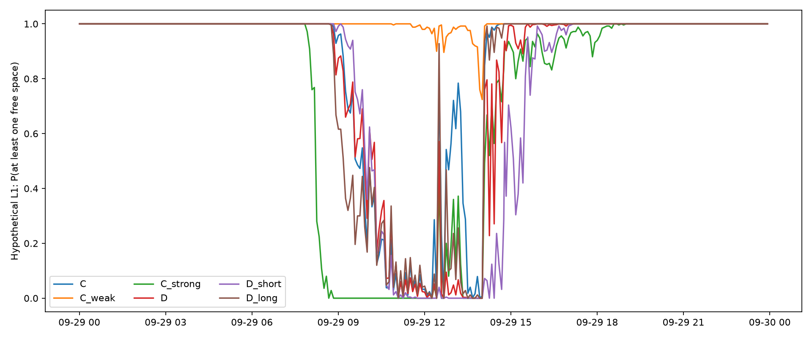

# T Deck 층별 주차 시뮬레이션 — 실행 결과

층별 가용성은 **총 잔여 대수만으로 식별되지 않는다**. 이번 결과에서 동일한 총 잔여 대수에도 오전·오후 층별 분포가 크게 달랐고, 층 선호·회전율·주차시간 가정을 바꾸면 확률도 달라졌다. 여기의 확률은 가정을 조건으로 한 몬테카를로 결과이며, 실측으로 보정된 주차 성공 확률이 아니다. 기존 수집·예측 모델·워크플로·웹사이트는 변경하지 않았다.

## 자료와 출처

[GSU 공식 주차장 표](https://parking.gsu.edu/parking/parking-deck-addresses/)의 T Deck은 총 **1,431대**다. CSV/API 명목 용량은 **1,300대**다. 차이 **131대**의 원인은 확인되지 않았다. 재구성에는 일관되게 1,300대를 썼다. [공개 지도 정보](https://www.latlong.net/poi/t-deck-484416)는 건물 8층을 표시하지만, 독립적으로 주차 가능한 8개 층이나 각 층 접근성을 검증하지 않는다. 출처 확인일 2026-10-13.

데이터 스냅샷: `2026-09-03T12:21:57-04:00` ~ `2026-10-13T21:30:14-04:00`, **11,767건**. 기반 커밋 `79886754e40a54a1bbb276c6bac0afbce16f7f6d`; CSV SHA256 `86598bdcf8e3223553954047dd64faeb2b378f50af10c5304b5513c238cf7f97`.

* 음수 74건, 0대 6건; 범위 -114~1299대. 중복 타임스탬프 0건.
* 관측 간격 중앙값 300초, 최장 7795초. 10분 초과 간격 30곳, 15분 초과 10곳.
* 10분 이내 200대 초과 순변화 1곳. 급변 기준은 감사용 휴리스틱이며 센서 오류 판정이 아니다.
* 음수는 원본과 감사 CSV에 그대로 남겼다. 본 실험은 불가능 관측을 제외하고, 직후·긴 공백·급변에서 상태를 재초기화한다. 이 구간의 차량 이동을 추정하지 않는다. 0대는 유효한 만차 상태다. `negative_clip`은 음수를 만차로 조정하는 별도 민감도 실험이다.



## 구현과 실험 범위

관측 `N=1300-F`의 순변화에 보이지 않는 동시 회전 `R`을 더해 `I=max(0,ΔN)+R`, `O=max(0,-ΔN)+R`로 구성한다. 실제 시간 간격을 사용하며, 출차 후 입차로 처리한다. 각 주차칸에 차량 도착시각·출차 예정시각을 저장한다. 입차는 빈 주차칸에 `exp(-β×가상 층 인덱스)` 가중치를 주어 무작위 배정한다. 출차는 층 순서가 아니라 가장 이른 예정시각으로 정한다.

가상 용량 A: `[163,163,163,163,162,162,162,162]`, B: `[120,160,180,180,180,180,160,140]`, C: `[140,180,200,220,200,190,170]`. 모두 합계 1,300, 양의 정수다. 실제 층번호·경사로·전용층을 의미하지 않는다. 근거 있는 네 번째 배치는 찾지 못해 추가하지 않았다.

모델 A는 시간대 회전율(평일 0.1~1.8대/분, 주말 0.3배; 낮음/중간/높음 0.3/1/3배), B는 `λ=0.15+0.35|v|`, C는 B에 `3분×|a|`를 추가한다. 점유 대수는 시정수 15분의 과거 방향 지수평활로 계산한다. 속도는 대/분, 가속도는 대/분²다. 이 미분량이 실제 회전율을 식별하지는 않는다.

D는 개별 주차시간에서 예정된 출차를 생성한다. 관측 순감소를 설명하기에 부족하면 추가 차량을 조기 출차시킨다. 입차는 `I=ΔN+O`로 맞춘다. A/B/C도 주차시간으로 출차 순서를 정하지만 가정된 출차 건수 때문에 조기 출차 또는 예정시각 초과 잔류가 생긴다. 따라서 주차시간 분포를 그대로 실현한 자유로운 차량 시뮬레이터가 아니다.

주차시간은 로그정규(기본 평균 4시간/CV0.55, 짧음 2시간/CV0.65, 김 6시간/CV0.55). 초기 차량 나이는 0~1/4/8시간 균등분포이며 그 나이까지 살아남았다는 조건으로 총 주차시간을 추출했다. 초기 차량 총수는 관측값으로 맞추며 매일 빈 주차장으로 시작하지 않는다. 전체 이력 재생에서는 자정을 넘어 차량 상태가 이어진다.

주요 A/B/C/D 각각 **1,000회**, 9월29일과 10월13일 총 **555개 관측**을 선택해 날짜별 독립 초기화 후 시간순 재생했다. 9월29일은 오전·오후 동일 총량 비교가 가능하고, 10월13일은 음수·급변을 포함한다. 민감도 11개는 9월29일 **250회**씩 실행했다. 선택일 결과를 전체 학기 대표 추정으로 일반화하지 않는다. 모든 조합을 1,000회 실행하는 대신 다음 추가 실험으로 이력·주말·불가능 관측 정책을 점검했다.

| 추가 실험 | 반복 | 관측 수 | 저장된 유효 시점 | 초기화 | 보존 검사 | 실행 초 |
|---|---|---|---|---|---|---|
| full_history | 100 | 11767 | 11693 | 19 | 1169300 | 223.2 |
| weekend_A | 1000 | 294 | 294 | 1 | 294000 | 56.7 |
| negative_clip | 250 | 264 | 264 | 2 | 66000 | 16.4 |

아래 본 실험 표의 출차는 두 선택일 합계/반복이다. 예정시간 초과 잔류는 같은 차량이 여러 시점에 중복 포함되는 **차량-관측 건수**다.

| 모델 | 반복 | 유효 시점 | 초기화 | 출차/반복 | 조기 출차 비율 | 예정 초과 잔류/반복 | 회전 제한/반복 |
|---|---|---|---|---|---|---|---|
| A | 1000 | 534 | 3 | 4394.6 | 19.0% | 74271.5 | 1.1 |
| B | 1000 | 534 | 3 | 4411.5 | 28.0% | 83410.9 | 3.3 |
| C | 1000 | 534 | 3 | 4810.0 | 33.2% | 73726.2 | 4.3 |
| D | 1000 | 534 | 3 | 5920.4 | 19.7% | 0.0 | 0.0 |

재구성을 맞추기 위한 조정이 적지 않은 모델은 가정과 관측 순변화가 충돌한다는 뜻이다. 이 조정률을 실제 운전자 행동으로 해석하면 안 된다. 시간 간격 안의 여러 번 회전은 생략하며 입차시각은 관측 끝점으로 근사했다.

## 같은 총 잔여 116대, 다른 이동 이력

9월29일 **11:35:15**와 **14:35:12** 모두 관측 잔여 **116대**다. 다음은 실제 실행된 값이다. L1은 가상 최하층, 마지막 층은 시나리오에 따라 L8 또는 L7이다.

| 시나리오 | 오전 L1 빈자리 확률 | 오후 L1 확률 | 오전 L1 기대 빈자리 | 오후 L1 기대 빈자리 | 오전 마지막 층 기대 | 오후 마지막 층 기대 |
|---|---|---|---|---|---|---|
| A | 2.9% | 99.3% | 0.029 | 5.628 | 68.33 | 25.44 |
| B | 2.2% | 100.0% | 0.023 | 9.558 | 70.16 | 25.25 |
| C | 3.1% | 99.8% | 0.031 | 7.042 | 69.61 | 25.77 |
| D | 2.4% | 82.5% | 0.025 | 1.960 | 65.08 | 32.23 |
| C_layout_B | 2.4% | 99.6% | 0.024 | 4.684 | 62.75 | 23.55 |
| C_layout_C | 8.4% | 100.0% | 0.088 | 6.280 | 66.60 | 25.22 |
| C_weak | 98.8% | 100.0% | 5.196 | 13.152 | 29.07 | 16.56 |
| C_strong | 0.0% | 79.6% | 0.000 | 2.168 | 98.03 | 29.08 |
| D_short | 0.0% | 12.4% | 0.000 | 0.140 | 59.82 | 40.91 |
| D_long | 4.4% | 98.4% | 0.044 | 5.804 | 68.90 | 25.93 |
| C_young | 2.8% | 99.6% | 0.028 | 7.108 | 69.02 | 25.43 |
| C_old | 2.8% | 99.6% | 0.028 | 7.108 | 69.02 | 25.43 |
| A_low | 1.6% | 100.0% | 0.016 | 15.672 | 71.38 | 23.66 |
| A_high | 0.8% | 63.2% | 0.008 | 1.092 | 63.55 | 34.11 |
| C_uniform_initial | 2.8% | 99.6% | 0.028 | 7.108 | 69.02 | 25.43 |

오전 입차로 아래층부터 채워진 상태와 오후 출차로 여러 층에 빈자리가 생긴 상태가 다르게 나타난다. 이는 차량 이력과 선호 가정에서 나온 결과이며, 실제 T Deck이 이 분포를 따른다는 증거는 아니다. 각 시점의 모든 층 기대 빈자리 합은 정확히 116대다.



## 가정에 대한 민감도와 2차 미분

모든 비교는 같은 9월29일 시각·가상 층끼리 대응했다. 평균 차이는 층별 기대 빈자리의 평균 절댓값, 확률 차이는 최대 퍼센트포인트다. 7층/8층 비교는 L1~L7만 대응하며 실제 같은 물리층이라고 주장하지 않는다. 작은 차이는 250회 민감도 실험의 몬테카를로 오차를 포함한다.

| 시나리오 | 비교 기준 | 평균 기대 빈자리 차이(대) | 최대 확률 차이(pp) | L1 최대 차이(pp) |
|---|---|---|---|---|
| B | C | 1.055 | 19.5 | 19.5 |
| C_layout_B | C | 10.469 | 16.0 | 16.0 |
| C_layout_C | C | 20.381 | 51.6 | 35.6 |
| C_weak | C | 9.724 | 100.0 | 100.0 |
| C_strong | C | 6.257 | 100.0 | 100.0 |
| D_short | D | 2.352 | 73.2 | 73.2 |
| D_long | D | 2.583 | 64.0 | 64.0 |
| C_young | C | 0.148 | 9.6 | 9.6 |
| C_old | C | 0.148 | 9.6 | 9.6 |
| A_low | A | 5.184 | 56.4 | 56.4 |
| A_high | A | 2.861 | 70.6 | 70.6 |
| C_uniform_initial | C | 0.160 | 9.6 | 9.6 |

C 대 B(2차 미분 계수 0)의 평균 층별 빈자리 차이는 **1.055대**, 최대 확률 차이는 **19.5pp**다. 해당 날짜 평균 1차 미분 회전 성분은 **0.609대/분**, 추가 2차 성분은 **0.162대/분**(최대 1.272)이었다. 2차 미분은 분포에 추가 변화를 만들지만, 정확도 개선을 검증할 층별 정답이 없다. 유용한 예측변수라는 결론은 내릴 수 없으며 미분 잡음·평활 상수 민감도도 추가 연구 대상이다.


자정의 초기 차량은 6대여서 주간 결과에서 초기 가정 효과가 거의 소멸했다. 위 초기 상태 항목의 작은 차이는 1,000회 기준과 250회 민감도의 표본 차이를 포함하므로 초기 상태 효과로 단정할 수 없다. 이를 보완해 9월29일 09:30의 **점유 800대**부터 16시까지 D 모델을 초기 혼합/젊음/오래됨/균등 배치별 **1,000회** 추가 실행했다. 같은 시드·같은 반복 수의 비교다. 초기화 이후 30분을 제외해도 차이가 남는지 별도 집계했다.

| 초기 가정 | 비교 구간 | 평균 기대 빈자리 차이(대) | 최대 확률 차이(pp) |
|---|---|---|---|
| young | all | 0.442 | 63.6 |
| young | after_30min | 0.384 | 52.2 |
| old | all | 0.167 | 8.4 |
| old | after_30min | 0.148 | 6.5 |
| uniform | all | 5.603 | 99.6 |
| uniform | after_30min | 2.846 | 74.4 |






층 배치·운전자 선호·주차시간·회전율·초기 상태에 따라 특정 층의 확률이 변한다. 가상 상층에 빈자리가 더 몰리는 오전 현상은 아래층 선호를 넣었기 때문에 생긴다. 실제 상층의 접근성이나 빈자리 보장을 뜻하지 않는다. 여러 가정에 걸쳐 검증된 층별 결론은 없으며, 안정적인 결론은 총량의 보존과 일부 산술적 제약뿐이다.

## 검증과 해석 한계

7개 단위 테스트가 통과했다: 모든 모델의 차량 보존·층 용량·음수 방지·관측 총량 일치·고정 시드 재현, 실제 확률적 분산, 음수/공백/불규칙 간격/중복, 초기 나이 및 배치 민감도, 미래 관측 변경에 대한 과거 평활 불변, 만차→빈 차고의 극단적 출차와 회전 상한. 전체 실행에서는 유효 시점마다 반복별 **4,781,550회** 보존·용량 검사를 수행했다. 합산 계산 시간은 약 **887.1초**(병행 작업 포함, 실제 대기 시간과 다름)다.

그림의 2.5~97.5 백분위는 **같은 가정 안에서 가능한 잠재 빈자리 분포**다. 실제 층별 진실의 95% 신뢰구간이 아니다. 1,000회 확률의 몬테카를로 표준오차는 최대 1.58pp, 250회는 3.16pp, 전체 이력 100회는 5pp다. 확률 0/100%도 표본 크기 때문에 절대적 불가능/보장으로 볼 수 없다. 가정을 바꾸는 불확실성은 이 표준오차에 포함되지 않는다.

총량이 0대이면 모든 가상 층이 만차다. 총 잔여가 0보다 크면 어딘가에 빈자리가 있지만 어느 층인지는 식별되지 않는다. 특정 층 용량이 `c`이고 전체 잔여가 `1300-c`보다 크면 그 층에 최소 한 자리는 있어야 한다는 산술적 제약만 확정할 수 있다. 출입 제한·실제 층 용량이 없으므로 실제 운전자 주차 가능성과도 구별해야 한다.

층별 정답, 실제 입·출차 건수, 체류시간, 층 선택 및 휴일/학기별 행동 자료가 없다. 전체 자료도 약 41일이고 센서 불가능값을 포함한다. 보존은 검증이 아니라 일관성 검사다. 합계 데이터가 더 쌓여도 동시 입·출차와 층별 분포의 비식별성이 저절로 없어지지 않는다. 실제 층별 안내에 사용하려면 층별 점유 관측 또는 표본 현장 조사로 가정을 보정·외부 검증해야 한다. 이 실험을 웹사이트에 배포하지 않았다.

## 결과 파일과 재현

`results/`에 원시 감사, 모든 시나리오 층별 CSV와 이동량 CSV, 설정·런타임·검사 횟수 JSON, 동일 총량 비교 CSV/NPZ, 14개 그림이 있다. `summary.json`과 `matched_floor_probabilities.json`은 연구용 JSON으로 비보정·가상 결과라는 경고를 포함한다. 실행 환경: {"python": "3.12.14", "numpy": "2.5.4", "pandas": "3.0.1", "scipy": "1.18.1", "matplotlib": "3.11.2"}.

저장소 루트에서:

```sh
python -m pip install -r floor_simulation/requirements.txt
python -m unittest discover -s floor_simulation -p 'test_*.py'
python floor_simulation/experiment.py
python floor_simulation/replay.py --model C --replications 100 --output floor_simulation/results/full_history
python floor_simulation/replay.py --model A --date 2026-09-27 --replications 1000 --output floor_simulation/results/weekend_A
python floor_simulation/replay.py --model C --date 2026-10-13 --policy clip --replications 250 --output floor_simulation/results/negative_clip
python floor_simulation/initial_stress.py
python floor_simulation/analyze.py
```

실시간 수집으로 CSV가 늘어난 뒤에는 위 기반 커밋의 CSV를 별도 파일로 저장하고 `--data`로 지정해야 같은 스냅샷을 재현한다. `config.json`에서 가정을 바꾸고 별도 `--output` 경로에 저장하면 기존 결과와 비교할 수 있다.
